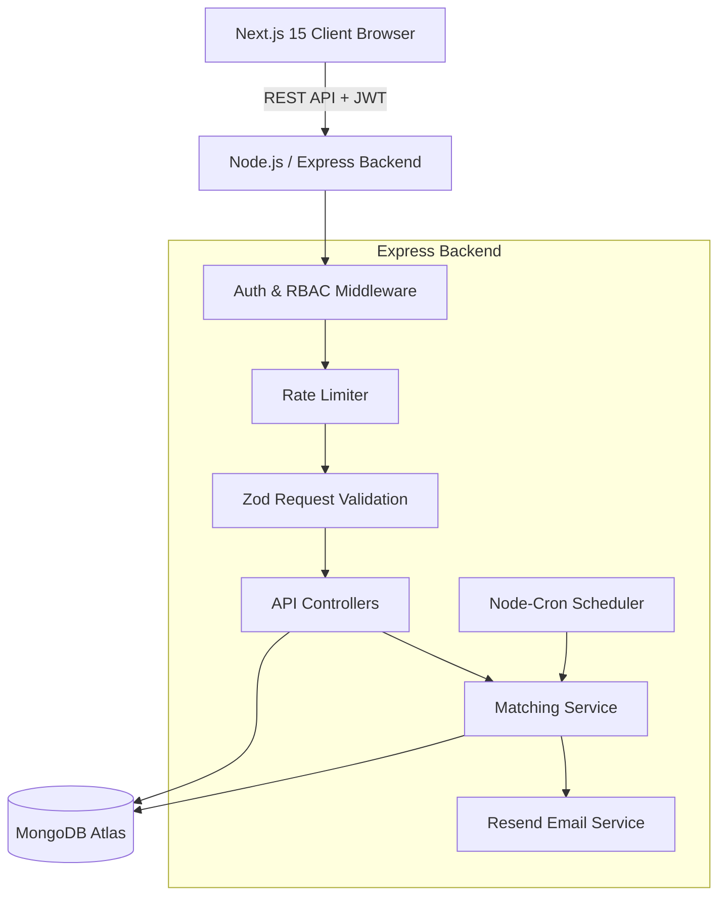

# System Architecture & Technical Design

## Overview
The Bangladesh Prize Bond Monitoring & Winner Notification Platform is an automated, web-native system designed to monitor official Bangladesh Bank 100 Taka prize bond draws, perform high-performance batch matching against millions of saved bonds, and notify winning bondholders in real-time.



---

## 1. Automated Matching Engine Design

The matching engine is designed to be **idempotent, batch-processed, and resilient to duplicate executions**.

### Key Matching Principles:
1. **Official Verification Gate**: Matches are strictly computed only when an admin verifies and publishes official Bangladesh Bank gazette numbers. Unverified drafts NEVER trigger matches or user notifications.
2. **60-Day Holding Eligibility Rule**:
   $$\text{Days Held} = \frac{\text{Draw Date} - \text{Purchase Date}}{1000 \times 60 \times 60 \times 24}$$
   If $\text{Days Held} < 60$, the bond is deemed ineligible for that draw (as per Bangladesh Bank regulations) and is skipped.
3. **Compound Database Constraints**:
   Duplicate prevention is enforced at the database level:
   ```ts
   MatchSchema.index(
     { draw: 1, user: 1, bond: 1, prizeCategory: 1 },
     { unique: true }
   );
   ```
4. **Tax Calculation (Section 55)**:
   - Source Withholding Tax Rate: `20%`
   - Estimated Tax: $\text{Gross} \times 0.20$
   - Net Receivable: $\text{Gross} - \text{Estimated Tax}$
5. **2-Year Claim Deadline (730 Days)**:
   $$\text{Claim Deadline} = \text{Draw Date} + 730\text{ days}$$
   Matches automatically track time remaining until expiration.

---

## 2. MongoDB Data Models & Indexing

| Collection | Key Fields | Indexes & Constraints |
| :--- | :--- | :--- |
| `User` | `name`, `email`, `password`, `role`, `notificationPreferences` | `email` (unique) |
| `PrizeBond` | `user`, `bondNumber`, `series`, `purchaseDate`, `isEnabled` | `{ user: 1, bondNumber: 1, series: 1 }` (unique compound) |
| `Draw` | `drawNumber`, `drawDate`, `isVerified`, `isPublished` | `drawNumber` (unique), `drawDate` (-1) |
| `WinningNumber`| `draw`, `bondNumber`, `prizeCategory`, `prizeAmount` | `{ draw: 1, bondNumber: 1, applicableSeries: 1 }`, `bondNumber` |
| `Match` | `user`, `bond`, `draw`, `grossAmount`, `estimatedTax`, `netAmount` | `{ draw: 1, user: 1, bond: 1, prizeCategory: 1 }` (unique) |
| `Notification` | `user`, `type`, `title`, `message`, `isRead` | `{ user: 1, createdAt: -1 }`, `isRead` |
| `JobExecution` | `jobName`, `status`, `bondsChecked`, `matchesFound`, `duration` | `startedAt` (-1) |
| `EmailLog` | `recipientEmail`, `subject`, `status`, `attempts` | `{ recipientEmail: 1, status: 1 }` |
| `AuditLog` | `user`, `action`, `entityType`, `details` | `createdAt` (-1) |

---

## 3. Scheduled Worker & Resilience
- **Node-Cron Service**: Executes periodic checks for verified draws that have not yet undergone matching.
- **Auto-Retry Mechanism**: Detects failed email logs and retries delivery with exponential backoff up to 3 attempts.
- **Fail-Safe Offline Mode**: Backend database connection handles connection drops gracefully and retries without crashing the server.
